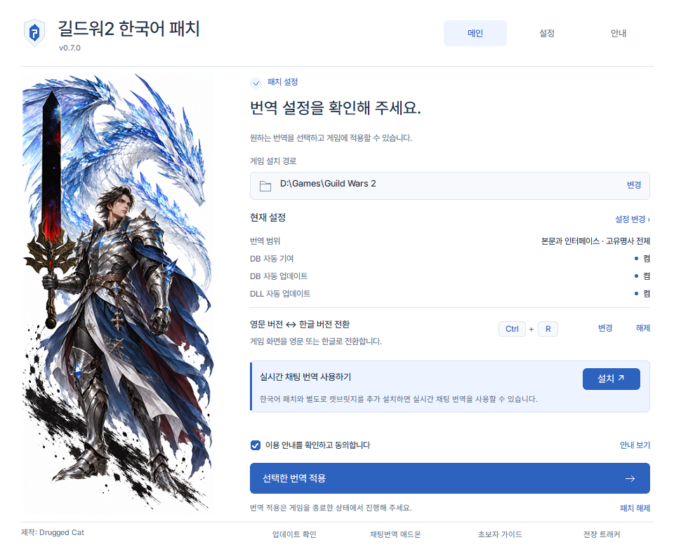
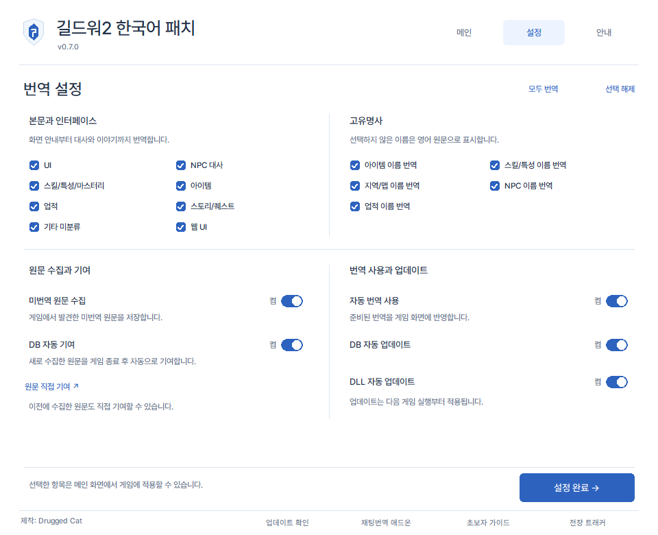

# 길드워2 한국어 패치

길드워2의 화면 안내, 대사, 아이템과 업적 등을 한국어로 즐길 수 있도록 만든 비공식 유저 패치입니다.

**[최신 패처 다운로드](https://github.com/motionsilse/gw2-korean-patch/releases/latest)** · [문제·오역 제보](https://guildwar.win/?lang=ko#list)

- **[길드워2 초보자 가이드](https://guildwar.win/)** — 처음 시작하는 분들을 위한 한국어 가이드입니다.
- **[실시간 채팅 번역 캣브릿지](https://catbridge.guildwar.win/)** — 다른 플레이어와의 채팅을 번역하는 애드온입니다. 한국어 패치와 **별도로 추가 설치**해 주세요.

## 번역은 어떻게 만들어지나요?

이 패치는 **제작자가 번역·검수해 배포하는 번역 DB**를 기본으로 사용합니다. DB에 아직 없는 문구는 다음 과정을 거쳐 보완합니다.

1. **임시 기계번역:** DB에 없는 영어 문구를 만나면 백그라운드에서 기계번역하고, 준비된 번역을 게임 화면에 임시로 표시합니다.
2. **원문 기여:** 수집한 미번역 원문은 DB 자동 기여가 켜져 있으면 게임 종료 후 제작자에게 전달됩니다.
3. **제작자의 번역·검수:** 제작자가 기여받은 원문을 분류하고, 게임의 문맥과 용어에 맞게 번역·검수합니다.
4. **DB 업데이트 배포:** 검수한 번역을 DB에 반영해 배포합니다. DB 자동 업데이트가 켜져 있으면 새 DB를 받아 다음 게임 실행부터 사용합니다. DB에 반영된 문구에는 검수된 번역이 우선 적용됩니다.

플레이 중 먼저 보이는 **임시 기계번역에는 오역이나 어색한 표현이 있을 수 있습니다.** 원문 기여와 제작자의 번역·검수를 거쳐 DB를 꾸준히 개선하고 있습니다.

## 처음 사용한다면

1. 길드워2를 종료한 뒤, 위 다운로드 페이지의 **Assets**에서 패처 `.exe`를 받습니다. `.zip`은 같은 실행 파일을 압축한 것입니다.
2. 패처를 실행하고 **게임 설치 경로**가 `Gw2-64.exe`가 있는 폴더인지 확인합니다.
3. 이용 안내를 읽고 동의한 뒤 **선택한 번역 적용**을 누릅니다.
4. 길드워2를 실행합니다.

**설정이 어렵다면 모든 번역과 기능이 켜진 기본값을 그대로 사용하세요.** 기존 사용자는 저장된 설정을 먼저 확인해 주세요.

## 원하는 방식으로 사용하기

- **번역 범위 선택:** 설정에서 UI, NPC 대사, 스킬·특성·마스터리, 아이템, 업적, 스토리·퀘스트, 웹 UI 등을 선택할 수 있습니다.
- **영문 이름 유지:** 이미 길드워2를 오래 플레이해서 영어가 익숙한 유저라면 고유명사 항목에서 아이템·스킬·지역 등의 이름 번역만 끌 수 있습니다.
- **영문 버전 ↔ 한글 버전 전환:** 기본 단축키는 **Ctrl + R**입니다. 메인 화면에서 변경하거나 해제할 수 있으며, 기존에 지정한 키는 유지됩니다. (제작, 업적등 위키 검색할 때 즉시 전환하여 편하게 사용 할 수 있습니다.)
- **한글 검색:** 업적, 거래소와 젬스토어에서 한글 입력·검색을 지원합니다.

번역 항목을 바꾼 뒤에는 **설정 완료 → 선택한 번역 적용**을 눌러 주세요. 적용과 해제는 게임이 종료된 상태에서 진행합니다.

번역 설정 화면 보기

## 자동 번역·기여·업데이트

| 설정 | 하는 일 |
| --- | --- |
| **미번역 원문 수집** | 게임에서 발견한 미번역 영어 문구를 저장합니다. |
| **DB 자동 기여** | 새로 수집한 원문을 게임 종료 후 자동으로 기여합니다. |
| **자동 번역 사용** | DB에 없는 문구의 임시 기계번역을 게임 화면에 표시합니다. |
| **DB 자동 업데이트** | 제작자가 번역·검수해 배포한 새 DB를 받습니다. |
| **DLL 자동 업데이트** | 한글 패치의 기능 개선과 오류 수정을 받습니다. |

새 설치의 기본값은 모두 **켬**이며, 각 설정은 따로 변경할 수 있습니다. 기존 사용자도 DLL 자동 업데이트로 0.7.0 이상을 받으면 자동 기여를 이용할 수 있습니다. 기여 설정이 없으면 켜지고, 직접 꺼 둔 선택은 유지됩니다.
기여 설정은 게임플레이에 영향을 주지 않으며 게임DB의 번역되지 않은 문구를 기여합니다.

- 임시 기계번역과 자동 기여를 이용하려면 **미번역 원문 수집**도 켜 두세요.
- 이전에 수집한 원문은 설정의 **원문 직접 기여**에서 확인하고 보낼 수 있습니다.
- 임시 기계번역은 백그라운드에서 처리되며, 통신 상태 등에 따라 표시까지 시간이 걸릴 수 있습니다.
- 다운로드가 완료된 DB·DLL 업데이트는 **다음 게임 실행부터** 적용됩니다.

**DLL 자동 업데이트는 패처 실행 파일 자체를 바꾸지는 않습니다.** 새 패처 화면과 설정을 이용하려면 [최신 패처](https://github.com/motionsilse/gw2-korean-patch/releases/latest)를 직접 받아 실행해 주세요. 패처 하단의 **업데이트 확인**에서도 다운로드 페이지를 열 수 있습니다.

## 실시간 채팅 번역

다른 플레이어와의 채팅을 번역하려면 [캣브릿지(CatBridge)](https://catbridge.guildwar.win/)를 **별도로 추가 설치**해 주세요. 패처 메인 화면의 **실시간 채팅 번역 사용하기 → 설치**에서도 연결됩니다.

## 게임 업데이트·패치 해제

- 게임 업데이트 전에는 게임을 종료하고 패처 메인 화면의 **패치 해제**를 눌러 주세요. 업데이트가 끝나면 다시 적용하면 됩니다.
- 패치를 제거할 때도 같은 **패치 해제** 버튼을 사용합니다.
- 수집한 원문과 사용자 번역 파일은 패치를 다시 적용하거나 해제해도 보존됩니다. 계속 사용하려면 게임 폴더 안의 `korean` 폴더를 삭제하지 마세요.

## 알아두세요

아직 번역되지 않은 문구나 오역이 있을 수 있습니다. 사용자 DB의 분류 정보, 같은 영어 단어의 여러 의미, 문구 형식이나 분류 오류에 따라 고유명사 설정이 일부 문구에 정확히 적용되지 않을 수 있습니다.

문제나 오역은 [커뮤니티](https://guildwar.win/?lang=ko#list)에 패처 버전, 발생 상황과 화면을 함께 알려 주세요. 백신이 다운로드나 실행을 차단했다면 이 저장소에서 받은 파일인지, 어떤 항목으로 탐지됐는지 확인해 주세요.

게임 내 번역 예시 보기

이전에 촬영한 게임 화면입니다. 현재 번역이나 표시 내용과는 차이가 있을 수 있습니다.

업로드 예정

---

제작: **Drugged Cat** · 기반 프로젝트: [nourlie/gw2-cyrillic](https://github.com/nourlie/gw2-cyrillic)
